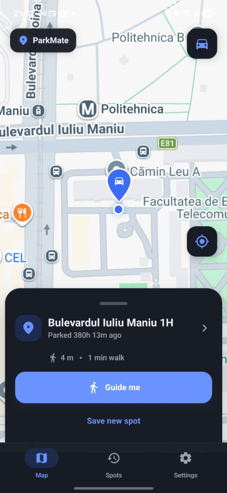
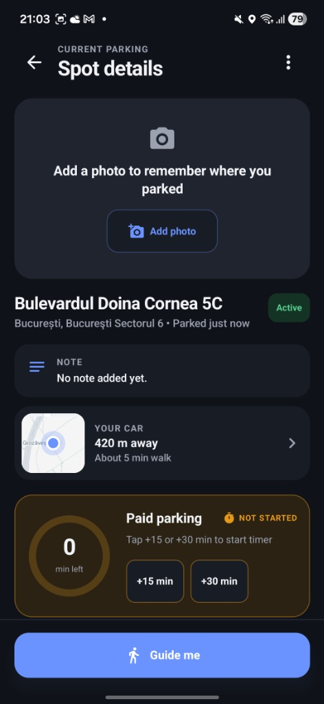
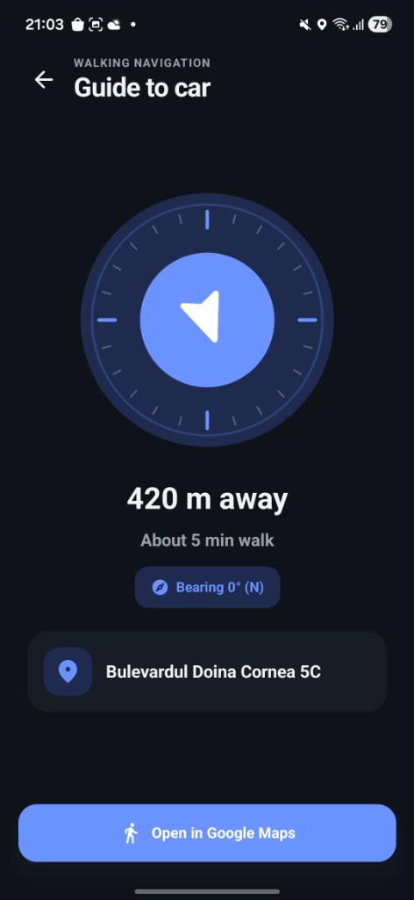
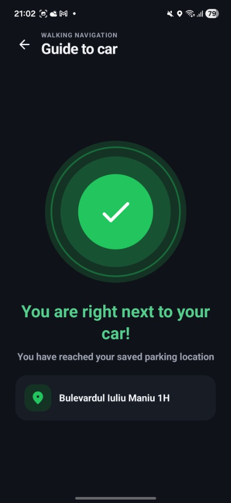
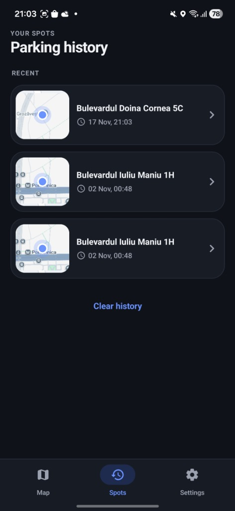
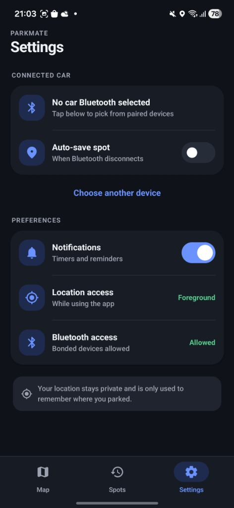

# 🚗 ParkMate — Native Android Parking Assistant

**ParkMate** is a modern native Android application built with **Kotlin**, **Jetpack Compose**, and **Material 3** (`compileSdk = 36`, `targetSdk = 36`, `minSdk = 26`). It helps drivers effortlessly remember where they parked—either manually with a single tap or automatically when their car's Bluetooth disconnects—enrich spots with annotated photos and quick location tags, track paid parking timers with proactive alerts, and navigate back to their vehicle using a real-time sensor compass.

---

## 📸 Screenshots

<p align="center">
  
  
  
</p>
<p align="center">
  <em>1. Interactive Map & Active Spot Summary &nbsp;|&nbsp; 2. Spot Details & Paid Parking Timer &nbsp;|&nbsp; 3. Live Compass Navigation</em>
</p>

<br/>

<p align="center">
  
  
  
</p>
<p align="center">
  <em>4. Arrival Confirmation State &nbsp;|&nbsp; 5. Parking History & Static Previews &nbsp;|&nbsp; 6. Bluetooth Auto-Save & Permissions</em>
</p>

---

## ✨ Key Features

- **🗺️ Interactive OpenStreetMap View (`osmdroid`)**
  - Displays the active parked car marker, live user location, and a dashed walking route overlay without requiring proprietary map API keys.
  - Bottom sheet summary showing reverse-geocoded street address, time elapsed since parking, live walking distance/duration, and quick actions (**Guide me** / **Save new spot**).
- **🤖 Automatic Bluetooth Disconnect Detection**
  - Pairs with your vehicle's Bluetooth audio system via `BluetoothDisconnectReceiver` (`ACTION_ACL_DISCONNECTED`).
  - Automatically captures high-accuracy GPS coordinates in the background when you turn off the ignition, reverse-geocodes the street address, persists the spot in Room, and dispatches a notification.
- **📸 CameraX Capture & Interactive Photo Annotations**
  - Built-in CameraX viewfinder with flash toggle, lens flip, and Android system photo picker integration.
  - Interactive **Review Photo** canvas supporting **Arrow**, **Circle**, and **Text** annotations burned directly into app-private JPEG storage (`filesDir/spot_photos`) to highlight pillar numbers, floors, or exits.
  - Full-screen multi-photo viewer (up to 4 photos per spot) with pinch-to-zoom, double-tap zoom, and native image sharing via `FileProvider`.
- **🏷️ Quick Tags & Notes**
  - One-tap underground/garage location chips (`Level -1`, `Level -2`, `Zone A`, `Zone B`, `Row 14`, `Pillar C4`, `Near elevator`, `Near exit`) plus custom text notes.
- **⏱️ Paid Parking Timer & Exact Alarms**
  - Quick `+15 min` and `+30 min` increments with a live circular countdown ring.
  - Configurable **10-minute pre-expiry warning** and **expiration alert** scheduled via `AlarmManager` (`ParkingTimerScheduler`).
- **🧭 Live Sensor Compass ("Guide to Car")**
  - Combines Haversine distance/bearing math (`LocationMath`) with hardware sensor fusion (`Sensor.TYPE_ROTATION_VECTOR` via `CompassSensorMonitor`) to point an arrow directly toward your parked vehicle.
  - Automatically transitions to a celebratory **"You are right next to your car!"** state when within arrival proximity, plus one-tap handoff to **Google Maps** walking directions.
- **🕓 Parking History & Bilingual Support**
  - Chronological log of past parking sessions with mini map previews, one-tap inspection, individual deletion, or full history clearing.
  - Full **English** (`values/strings.xml`) and **Romanian** (`values-ro/strings.xml`) localization and adaptive Dark/Light Material 3 theming.

---

## 🛠️ Tech Stack & Libraries

| Layer | Technology | Version | Purpose |
|---|---|---|---|
| **Language** | Kotlin | `2.0.21` | Coroutines, Flows, Kotlinx Serialization |
| **UI Framework** | Jetpack Compose + Material 3 | BOM `2024.12.01` | Declarative UI, Adaptive layouts, Custom Canvas dials |
| **Navigation** | Navigation Compose | `2.8.5` | Type-safe serialized route graphs (`ParkMateRoute`) |
| **Dependency Injection** | Dagger Hilt + KSP | `2.52` | Singleton system services, repositories, and `@HiltViewModel` |
| **Local Database** | Room (`SQLite`) | `2.6.1` | Reactive persistence for active & historical parking spots |
| **Preferences** | Jetpack DataStore | `1.1.2` | Storing paired Bluetooth MAC/name, auto-save flags, and preferences |
| **Map Engine** | `osmdroid-android` | `6.1.20` | OpenStreetMap vector/tile rendering & custom overlays |
| **Location** | Play Services Location | `21.3.0` | `FusedLocationProviderClient` for single-shot & continuous GPS updates |
| **Camera & Media** | CameraX + Coil | `1.4.1` / `2.7.0` | Camera2 capture pipeline and async image loading |
| **Background & Alarms** | BroadcastReceivers + AlarmManager | Android SDK | Bluetooth ACL disconnect handling & exact timer notifications |

---

## 🏗️ Architecture & Project Structure

ParkMate follows **Clean MVVM Architecture** with **Unidirectional Data Flow (UDF)**. UI screens observe immutable `StateFlow` states exposed by `@HiltViewModel` classes, which coordinate domain math, Room/DataStore repositories, and Android hardware controllers.

```text
app/src/main/java/com/parkmate/app/
├── core/
│   ├── math/
│   │   ├── LocationMath.kt              # Haversine distance, bearing, walking time & cardinal directions
│   │   └── ParkingTimerCalculator.kt    # Countdown math, progress ring ratios & warning thresholds
│   └── ui/
│       ├── components/                  # Reusable Material 3 cards, buttons, badges & permission dialogs
│       └── theme/                       # Color tokens, typography & dark/light theme definitions
├── data/
│   ├── local/
│   │   ├── ParkMateDatabase.kt          # Room database definition
│   │   ├── ParkingSpotDao.kt            # Reactive Flow queries & transactional spot updates
│   │   └── ParkingSpotEntity.kt         # Database table schema
│   ├── model/
│   │   ├── ParkingSpot.kt               # Domain model for parking sessions
│   │   └── UserSettings.kt              # Domain model for Bluetooth & notification preferences
│   └── repository/
│       ├── ParkingRepository*.kt        # Single source of truth for active & historical spots
│       └── SettingsRepository*.kt       # Preferences DataStore wrapper
├── di/
│   └── DataModule.kt                    # Hilt bindings for Room, DataStore & Repositories
├── feature/
│   ├── home/                            # HomeScreen (OSM map), QuickSaveScreen & HomeViewModel
│   ├── details/                         # SpotReadScreen, AddDetailsScreen, PaidParkingTimerCard & ViewModel
│   ├── camera/                          # CameraPermission, CameraCapture, PhotoReview & PhotoViewer screens
│   ├── guide/                           # GuideMeScreen (live compass + arrival state) & GuideMeViewModel
│   ├── history/                         # HistoryScreen (past spots list) & HistoryViewModel
│   └── settings/                        # SettingsScreen (Bluetooth picker & permissions) & SettingsViewModel
├── navigation/
│   ├── ParkMateNavHost.kt               # Compose NavHost & bottom navigation bar coordinator
│   └── ParkMateRoute.kt                 # Type-safe @Serializable navigation destinations
└── system/
    ├── bluetooth/                       # BluetoothCarMonitor & BluetoothDisconnectReceiver
    ├── camera/                          # PhotoStorageManager (JPEG persistence & annotation rendering)
    ├── location/                        # LocationClientHelper & LocationReverseGeocoder
    ├── notification/                    # ParkMateNotificationHelper (channels & system alerts)
    ├── sensor/                          # CompassSensorMonitor (Rotation Vector azimuth stream)
    └── timer/                           # ParkingTimerScheduler & ParkingTimerAlarmReceiver
```

---

## 🔐 Permissions & Privacy Model

All location and photo data stays **100% local on the user's device**. Permissions are requested contextually with clear rationale screens:

| Permission | Purpose | When Requested & Fallback Behavior |
|---|---|---|
| `ACCESS_FINE_LOCATION` & `ACCESS_COARSE_LOCATION` | High-accuracy GPS coordinates when saving a parking spot and live distance/bearing updates in **Guide to car**. | Requested when tapping **Park here** / **Save new spot** or as Step 1 of enabling **Auto-save spot**. Falls back to last-known/default coordinates if denied. |
| `ACCESS_BACKGROUND_LOCATION` | Allows `BluetoothDisconnectReceiver` to capture your vehicle's coordinates when Bluetooth disconnects while the app is closed. | Requested as Step 2 (after foreground location is granted) with an in-app rationale dialog and deep link to system settings. Manual parking always works without it. |
| `BLUETOOTH_CONNECT` (API 31+) / `BLUETOOTH` (API ≤30) | Reads bonded Bluetooth devices so you can select your car's audio system and verifies `ACL_DISCONNECTED` broadcasts. | Requested as Step 3 when enabling **Auto-save spot** or opening **Choose another device** in Settings. |
| `CAMERA` | Captures photos of parking pillars, levels, or entrances using CameraX. | Dedicated **Allow camera access** rationale screen (`CameraPermissionScreen`) before opening CameraX. Users can pick from the gallery without granting camera access. |
| `POST_NOTIFICATIONS` (API 33+) | Displays 10-minute warning alerts, timer expiry alerts, and auto-saved spot notifications. | Requested when starting a paid parking timer (`+15 min` / `+30 min`) or toggling **Notifications** in Settings. |
| `SCHEDULE_EXACT_ALARM` | Fires paid parking timer alerts at the exact warning and expiry timestamps. | Checked dynamically via `AlarmManager.canScheduleExactAlarms()`; automatically falls back to `AlarmManager.setWindow()` / `setAndAllowWhileIdle()` if exact alarms are not permitted. |

---

## 🚀 Setup & Build Instructions

### Prerequisites
- **Android Studio** Ladybug / Meerkat (or newer) with **JDK 17+**.
- **Android SDK Platform 36** and Build-Tools installed via SDK Manager.
- **No external API keys required** — `osmdroid` loads OpenStreetMap tiles out of the box.

### Building & Testing from the Command Line

1. **Clone the repository and navigate to the project root:**
   ```bash
   cd ParkMate
   ```
2. **Ensure `ANDROID_HOME` (or `local.properties` with `sdk.dir=...`) points to your Android SDK.**
3. **Build the debug APK:**
   ```bash
   ./gradlew assembleDebug
   ```
   The generated APK will be located at `app/build/outputs/apk/debug/app-debug.apk`.
4. **Run local JUnit tests (Location math, Timer calculator, and ViewModels):**
   ```bash
   ./gradlew testDebugUnitTest
   ```
5. **Run instrumented Room DAO & Compose UI tests on a connected device or emulator:**
   ```bash
   ./gradlew connectedDebugAndroidTest
   ```

---

## 🧪 How to Test Each Feature on a Device

1. **Home Map & Manual Save (`HomeScreen` → `QuickSaveScreen`)**
   - Launch ParkMate. The map displays the active car pin, your current location dot, and a dashed walking route line.
   - Tap **Save new spot** (or **Park here** when no spot is active) and grant foreground location permission.
   - The **Spot saved** quick-save sheet appears with your reverse-geocoded street address and actions: **Add photo**, **Add note**, and **Skip for now**.

2. **CameraX Capture, Gallery Picker & Photo Annotations (`CameraCaptureScreen` → `PhotoReviewScreen`)**
   - From the quick-save sheet or **Spot details**, tap **Add photo**.
   - Test **Flash toggle**, **Camera flip**, or the **Gallery picker**.
   - After capturing a photo, select the **Arrow**, **Circle**, or **Text** tool in the floating toolbar and tap on the image to place annotations. Tap **Use photo** to save.

3. **Quick Tags, Notes & Full-Screen Photo Viewer (`AddDetailsScreen` → `SpotReadScreen` → `PhotoViewerScreen`)**
   - Select any combination of quick tags (`Level -1`, `Zone A`, `Pillar C4`, etc.) and enter a custom note.
   - On **Spot details**, tap the photo carousel to open the full-screen viewer with pinch-to-zoom, horizontal swipe, and native **Share**.
   - Use the top-right overflow menu (`⋮`) to **Edit** or **Delete** the active spot.

4. **Paid Parking Timer & Notifications (`PaidParkingTimerCard`)**
   - Open **Spot details** and tap **+15 min** or **+30 min** on the amber **Paid parking** card.
   - Watch the circular countdown ring update in real time and toggle the 10-minute reminder alert.

5. **Guide to Car Compass & Arrival State (`GuideMeScreen`)**
   - Tap **Guide me** on the Home sheet or Spot details screen.
   - Walk toward your saved parking spot: the compass arrow rotates smoothly using `Sensor.TYPE_ROTATION_VECTOR` to point toward your car, displaying live distance, walking time, and cardinal bearing.
   - Once you reach the saved coordinates, the screen automatically switches to the green **"You are right next to your car!"** confirmation screen.
   - Tap **Open in Google Maps** at the bottom at any time for turn-by-turn street navigation.

6. **Bluetooth Disconnect Auto-Save (`SettingsScreen` & `BluetoothDisconnectReceiver`)**
   - Open the **Settings** tab, select your paired car Bluetooth device, and enable **Auto-save spot** (completing the Foreground Location → Background Location → Bluetooth Connect permission flow).
   - When your car Bluetooth disconnects, ParkMate automatically saves your current location and posts a **"Spot saved automatically"** notification.
   - **Tip — Simulate a Bluetooth disconnect via ADB:**
     ```bash
     adb shell am broadcast -a com.parkmate.app.ACTION_SIMULATE_BT_DISCONNECT -n com.parkmate.app/.system.bluetooth.BluetoothDisconnectReceiver
     ```
